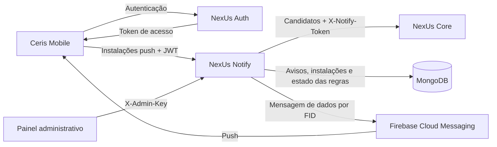

# NexUs Notify

API responsável pela geração e pelo envio de notificações do ecossistema Ceris: produtos próximos do vencimento, eventos, listas de compras e sugestões de lojas próximas.

O serviço consulta candidatos no NexUs Core, aplica as regras de cada alerta e persiste os avisos no MongoDB. Também gerencia as instalações Android usadas no envio pelo Firebase, oferece histórico por perfil e disponibiliza métricas para o painel administrativo.

## Sumário

- [Visão geral](#visão-geral)
- [Arquitetura](#arquitetura)
- [Tecnologias](#tecnologias)
- [Requisitos](#requisitos)
- [Configuração](#configuração)
- [Execução local](#execução-local)
- [Execução com Docker](#execução-com-docker)
- [Autenticação e autorização](#autenticação-e-autorização)
- [Endpoints](#endpoints)
- [Regras de negócio](#regras-de-negócio)
- [Integração com o Core e o Mobile](#integração-com-o-core-e-o-mobile)
- [Persistência e deduplicação](#persistência-e-deduplicação)
- [Limitação de requisições](#limitação-de-requisições)
- [Rotinas agendadas](#rotinas-agendadas)
- [Observabilidade](#observabilidade)
- [Erros e respostas HTTP](#erros-e-respostas-http)
- [Testes e qualidade](#testes-e-qualidade)
- [Build e implantação](#build-e-implantação)
- [Estrutura do projeto](#estrutura-do-projeto)
- [Considerações operacionais](#considerações-operacionais)
- [Solução de problemas](#solução-de-problemas)
- [Documentação complementar](#documentação-complementar)
- [Licença](#licença)

## Visão geral

O NexUs Notify combina uma API HTTP com processamento agendado de alertas.

Suas principais responsabilidades são:

| Área | Recursos |
| --- | --- |
| Produtos | Alertas de validade conforme as antecedências configuradas |
| Eventos | Lembretes de eventos fornecidos pelo Core |
| Listas de compras | Lembretes de listas com data definida |
| Lojas próximas | Sugestões por endereço cadastrado, com intervalo mínimo e rodízio |
| Novas lojas | Descoberta de novidades e prioridade na próxima sugestão elegível |
| Instalações push | Cadastro, associação ao perfil, revogação e invalidação de dispositivos |
| Envio | Mensagens de dados pelo Firebase para instalações ativas |
| Histórico | Consulta paginada dos avisos do perfil autenticado |
| Administração | Verificação de chave e métricas do serviço |

A emissão e a renovação de tokens pertencem ao NexUs Auth. Os dados de origem e a seleção de candidatos pertencem ao Core. O recebimento e a exibição no aparelho pertencem ao Mobile.

O serviço não mantém estado de leitura das notificações. A geração entra pelo agendador; não há endpoint público para criar avisos ou disparar o processamento manualmente.

## Arquitetura



### Organização dos dados

| Collection MongoDB | Uso |
| --- | --- |
| `notifications` | Avisos gerados e chave de deduplicação de cada alerta |
| `push_installations` | Instalações, vínculo com o perfil e estado de envio |
| `nearby_store_rotations` | Ciclo de lojas apresentadas e próxima data elegível por perfil |
| `new_store_suggestions` | Novidades descobertas, pendentes ou já apresentadas |
| `new_store_discovery_state` | Data até a qual a descoberta de novas lojas foi concluída |

O histórico administrativo de métricas e os contadores de limite de requisições permanecem na memória de cada instância. O Notify não depende de PostgreSQL ou Redis diretamente; as consultas aos dados do Core são feitas por HTTP.

## Tecnologias

| Tecnologia | Utilização |
| --- | --- |
| Java 17 | Linguagem e ambiente de execução |
| Spring Boot 4.1.0 | Inicialização e configuração da aplicação |
| Spring MVC | API HTTP |
| Spring Security | Segurança e autenticação |
| OAuth2 Resource Server | Validação local de JWT |
| Spring Data MongoDB | Persistência documental e transações |
| Firebase Admin SDK | Envio de mensagens de dados |
| Springdoc OpenAPI | Documentação da API e Swagger UI |
| Spring Boot Actuator / Micrometer | Saúde e métricas |
| Prometheus Registry | Exposição das métricas no formato Prometheus |
| Maven Wrapper | Build e execução |
| JUnit / Mockito / AssertJ | Testes |
| Checkstyle | Verificação do padrão de código |
| Docker / Kubernetes / Kustomize | Execução e implantação em containers |

As versões das dependências estão definidas no `pom.xml`.

## Requisitos

Para executar a aplicação:

- JDK 17.
- MongoDB acessível e base preparada com as collections e os índices necessários.
- Chave JWT e emissor compatíveis com o NexUs Auth.

Conforme os recursos utilizados:

- NexUs Core acessível e token compartilhado para gerar notificações.
- MongoDB com suporte a transações para sugestões de lojas.
- Projeto Firebase e credencial de conta de serviço para envio de push.
- Chave administrativa para acessar o painel e as métricas protegidas.
- Docker Engine, caso a execução seja feita por container.

O Maven Wrapper permite executar os comandos sem instalar o Maven separadamente.

### Preparação do MongoDB

A criação automática de índices está desabilitada:

```yaml
spring:
  data:
    mongodb:
      auto-index-creation: false
```

Prepare previamente as collections e os índices na base configurada em `MONGO_DB`. O Notify não administra o schema nem cria esses índices na inicialização.

| Índice | Collection | Finalidade |
| --- | --- | --- |
| `uq_notification_alert` | `notifications` | Unicidade de perfil, tipo, origem e chave de alerta |
| `idx_notification_profile_created` | `notifications` | Consulta de histórico por perfil e criação |
| `uq_push_installation_id` | `push_installations` | Unicidade do FID |
| `idx_push_installation_profile_status` | `push_installations` | Busca de instalações ativas do perfil |
| `idx_new_store_suggestion_profile_presented` | `new_store_suggestions` | Busca de novidades pendentes |

Os comandos e os formatos dos documentos estão nos guias de [instalações push](docs/push-installations.md) e [lojas próximas](docs/nearby-stores.md).

O fluxo de lojas exige replica set ou cluster com suporte a transações, mesmo com o push desabilitado. Um MongoDB standalone pode atender aos fluxos de produtos, eventos e listas quando `NOTIFY_NEARBY_STORES_ENABLED=false`.

## Configuração

Copie `.env.example` para `.env` na raiz do projeto e preencha os valores do seu ambiente.

**PowerShell:**

```powershell
Copy-Item .env.example .env
```

**Linux/macOS:**

```bash
cp .env.example .env
```

A aplicação também aceita `.env.properties`. Os dois arquivos utilizam `CHAVE=VALOR`, sem aspas envolvendo os valores. Se ambos existirem, `.env.properties` tem prioridade. Variáveis do processo têm prioridade sobre os arquivos locais.

### Conexões e autenticação

| Variável | Padrão | Descrição |
| --- | --- | --- |
| `MONGO_URI` | Sem padrão na aplicação | URI de conexão com o MongoDB |
| `MONGO_DB` | Sem padrão na aplicação | Nome da base das collections do Notify |
| `NOTIFY_PORT` | `8082` | Porta HTTP |
| `JWT_SECRET_BASE64` | Sem padrão | Chave de validação JWT, compartilhada com o Auth e codificada em Base64 |
| `JWT_ISSUER` | `nexus-auth` | Emissor esperado no token |
| `CORS_ALLOWED_ORIGINS` | Vazio | Origens de navegador permitidas, separadas por vírgulas |

A chave JWT deve representar pelo menos 32 bytes após a decodificação Base64. Utilize a mesma chave e o mesmo emissor configurados no Auth. O aplicativo envia o token de acesso, e não a chave do servidor.

O `.env.example` fornece valores locais de exemplo para MongoDB. Eles devem ser ajustados à base e à topologia utilizadas.

Exemplo de origens de navegador:

```dotenv
CORS_ALLOWED_ORIGINS=http://localhost:3000,http://localhost:5173
```

### Integração com o Core

| Variável | Padrão | Descrição |
| --- | --- | --- |
| `CORE_BASE_URL` | `http://localhost:8080` | Endereço do NexUs Core |
| `NOTIFY_CORE_TOKEN` | Vazio | Token enviado no header `X-Notify-Token` |
| `CORE_CONNECT_TIMEOUT` | `2s` | Tempo máximo para estabelecer a conexão |
| `CORE_READ_TIMEOUT` | `5s` | Tempo máximo de espera pela resposta |

Configure o mesmo `NOTIFY_CORE_TOKEN` nos dois serviços. Sem ele, o Notify rejeita a tentativa de consulta antes de enviar a requisição ao Core. O token é necessário para a geração, mas não é uma credencial da API pública do Notify.

### Firebase e envio de push

| Variável | Padrão | Descrição |
| --- | --- | --- |
| `NOTIFY_PUSH_ENABLED` | `false` | Inicializa o Firebase e habilita o envio |
| `FIREBASE_PROJECT_ID` | Vazio | Identificador do projeto Firebase |
| `FIREBASE_CREDENTIALS_BASE64` | Vazio | JSON da conta de serviço codificado em Base64 |

Com `NOTIFY_PUSH_ENABLED=false`, o Firebase não é inicializado e suas credenciais não são exigidas. A geração e a persistência de avisos continuam funcionando.

Para habilitar o envio, utilize a credencial de uma conta de serviço com permissão de envio no projeto. O projeto declarado deve corresponder ao da credencial. O `google-services.json` do Android não substitui a credencial privada do servidor.

Para converter o JSON em Base64 no PowerShell, substitua o caminho pelo arquivo real:

```powershell
$firebaseKeyPath = 'C:\caminho\credencial-notify.json'
[Convert]::ToBase64String([IO.File]::ReadAllBytes($firebaseKeyPath)) | Set-Clipboard
```

Configure os valores:

```dotenv
NOTIFY_PUSH_ENABLED=true
FIREBASE_PROJECT_ID=seu-projeto-firebase
FIREBASE_CREDENTIALS_BASE64=VALOR_COPIADO
```

Base64 é uma codificação; o valor continua sendo uma credencial privada. O arquivo original e seu conteúdo não devem ser incluídos no Git, no JAR ou na imagem Docker.

### Administração

| Variável | Padrão | Descrição |
| --- | --- | --- |
| `ADMIN_API_KEY` | Vazio | Chave de acesso administrativo |
| `ADMIN_METRICS_STEP_MS` | `60000` | Intervalo entre amostras de métricas, em milissegundos |
| `ADMIN_METRICS_RETENTION_MINUTES` | `720` | Retenção das amostras em memória, em minutos |

`TRACING_ACESS` é aceito como alternativa de compatibilidade. Para novas configurações, utilize `ADMIN_API_KEY`.

### Rate limit

| Variável | Padrão | Descrição |
| --- | --- | --- |
| `RATE_LIMIT_REQUESTS_PER_MINUTE` | `60` | Cota compartilhada das rotas autenticadas `/api/**` por perfil |
| `RATE_LIMIT_MAX_ENTRIES` | `100000` | Capacidade máxima da estrutura de contadores em memória |

Essas variáveis e `CORS_ALLOWED_ORIGINS` são aceitas pela aplicação mesmo não estando listadas no `.env.example` atual.

### Regras e agendamento

| Variável | Padrão | Descrição |
| --- | --- | --- |
| `NOTIFY_SCHEDULER_ENABLED` | `true` | Habilita o agendador de geração de avisos |
| `NOTIFY_SCHEDULER_CRON` | `0 0 11 * * *` | Horário da geração, no formato Spring com seis campos |
| `NOTIFY_NEARBY_STORES_ENABLED` | `true` | Habilita descoberta e sugestões de lojas |
| `NOTIFY_NEARBY_STORES_RADIUS_KM` | `5` | Raio das consultas de lojas; maior que zero e até 100 km |
| `NOTIFY_NEARBY_STORES_INTERVAL_DAYS` | `3` | Intervalo mínimo entre sugestões por perfil; mínimo de 3 dias |

As demais propriedades estão em `application.yml`, sob `notify.notification`:

| Propriedade | Padrão | Descrição |
| --- | --- | --- |
| `product-days-before` | `[3, 1, 0]` | Antecedências dos alertas de produtos |
| `event-days-before` | `[7, 3, 1, 0]` | Antecedências dos alertas de eventos |
| `shopping-list-days-before` | `[7, 3, 1, 0]` | Antecedências dos lembretes de listas |
| `page-size` | `100` | Tamanho do lote consultado no Core; entre 1 e 500 |
| `zone-id` | `America/Sao_Paulo` | Fuso da data de referência e do agendador |

As antecedências devem formar listas não vazias de inteiros não negativos. Ao alterar as janelas de consulta, respeite também o intervalo aceito pelo Core.

## Execução local

### 1. Obtenha o projeto

```bash
git clone https://github.com/NexUs-ofc/NexUs-Notify.git
cd NexUs-Notify
```

### 2. Prepare o banco e as integrações

Prepare o MongoDB com os índices necessários e, para lojas, com suporte a transações. Disponibilize o Core e configure o token compartilhado para a geração.

Para trabalhar inicialmente apenas com produtos, eventos e listas, utilize:

```dotenv
NOTIFY_NEARBY_STORES_ENABLED=false
```

Para testar somente a API, sem geração automática ou Firebase:

```dotenv
NOTIFY_SCHEDULER_ENABLED=false
NOTIFY_PUSH_ENABLED=false
```

O MongoDB e a configuração JWT continuam necessários nesse cenário.

### 3. Configure o ambiente

Preencha o `.env` com a conexão MongoDB, o emissor e a chave JWT. Configure Core, Firebase e administração conforme os recursos utilizados.

### 4. Inicie a aplicação

**PowerShell:**

```powershell
.\mvnw.cmd spring-boot:run
```

**Linux/macOS:**

```bash
./mvnw spring-boot:run
```

Por padrão, a API fica disponível em:

```text
http://localhost:8082
```

### 5. Verifique a inicialização

```bash
curl http://localhost:8082/actuator/health
```

O endpoint público verifica o estado do MongoDB, mas não confirma a comunicação com o Core nem a entrega pelo Firebase.

## Execução com Docker

O projeto fornece um `Dockerfile` com build e runtime separados. MongoDB, Core e as demais integrações devem estar acessíveis a partir do container.

### Configuração básica

Com Docker Engine em execução e o `.env` preparado:

```bash
docker build -t nexus-notify:local .
docker run --rm --name nexus-notify --env-file .env -e NOTIFY_PORT=8080 -p 8080:8080 nexus-notify:local
```

Nesse exemplo, a API fica disponível em `http://localhost:8080`.

O `Dockerfile` define `NOTIFY_PORT=8080`. O argumento `-e NOTIFY_PORT=8080` também fixa essa porta quando o `.env` foi copiado do exemplo local, que define `8082`, mantendo o mapeamento `8080:8080` coerente.

### Conexões e acompanhamento

Dentro do container, `localhost` aponta para o próprio container. Ajuste `MONGO_URI` e `CORE_BASE_URL` para endereços alcançáveis pela rede Docker.

Acompanhe os logs:

```bash
docker logs -f nexus-notify
```

Encerre a execução:

```bash
docker stop nexus-notify
```

A imagem final utiliza Java 17 e um usuário sem privilégios de root. Credenciais são fornecidas no ambiente de execução. O projeto não inclui `docker-compose.yml`; o procedimento completo de Kubernetes está no [guia de containers](docs/containers.md).

## Autenticação e autorização

### API do aplicativo

As rotas `/api/**` recebem:

```http
Authorization: Bearer <ACCESS_TOKEN>
```

O Notify valida o token localmente com:

- Assinatura HS256.
- Chave compartilhada com o Auth.
- Emissor configurado em `JWT_ISSUER`.
- Validações temporais do JWT.

O `sub` deve conter um identificador numérico positivo e determina o perfil consultado ou associado à instalação. A claim `profile_type` é convertida em autoridade com prefixo `ROLE_`.

O cliente não escolhe outro perfil pelo corpo ou pelos parâmetros dessas rotas. A consulta de histórico e a revogação são limitadas ao perfil do JWT.

### Acesso público

Dispensam JWT:

- `GET /actuator/health`.
- `/swagger-ui.html` e `/swagger-ui/**`.
- `/v3/api-docs`, `/v3/api-docs/**` e `/v3/api-docs.yaml`.

A liberação pública de saúde é para o caminho exato `/actuator/health`. Os subcaminhos `/actuator/health/liveness` e `/actuator/health/readiness` continuam protegidos pela configuração de segurança atual.

### Integração com o Core

Nas consultas de candidatos, o Notify envia ao Core:

```http
X-Notify-Token: <NOTIFY_CORE_TOKEN>
```

Esse header autentica a chamada no Core. Ele não substitui o JWT nas rotas do Notify.

### Administração

As rotas `/admin/**` utilizam:

```http
X-Admin-Key: <ADMIN_API_KEY>
```

A mesma chave protege `/actuator/metrics`, `/actuator/metrics/**` e `/actuator/prometheus`. Nessas rotas do Actuator, o parâmetro `key` também é aceito por compatibilidade com coletores.

A chave administrativa e o JWT atendem a fluxos diferentes. O JWT de usuário não substitui `X-Admin-Key` no painel.

### Política de tokens

O Notify opera sem sessão de usuário no servidor e não consulta o Auth a cada requisição.

A validação criptográfica não oferece revogação imediata de JWTs. O logout pode revogar o vínculo da instalação push, mas não invalida automaticamente um token de acesso já emitido. Mensagens aceitas pelo Firebase antes da revogação podem continuar em trânsito; o Mobile também precisa validar a sessão antes da exibição.

## Endpoints

Os caminhos abaixo são relativos à URL base da aplicação. A documentação detalhada está disponível em:

```text
/swagger-ui/index.html
/v3/api-docs
```

No Swagger, informe somente o JWT no esquema `BearerAuth`, sem escrever o prefixo `Bearer`. As operações administrativas utilizam o esquema `AdminKeyAuth`.

### Histórico

| Método | Rota | Descrição |
| --- | --- | --- |
| `GET` | `/api/notifications` | Lista os avisos do perfil autenticado, com paginação |

Parâmetros:

- `page`: índice da página, começando em `0`.
- `size`: quantidade por página, padrão `20`, entre `1` e `100`.

A ordenação é por criação decrescente e, em caso de empate, identificador decrescente. A resposta contém `content` e `hasNext`, sem contagem total:

```json
{
  "content": [
    {
      "id": "670c00000000000000000001",
      "type": "PRODUCT_EXPIRING",
      "sourceId": "45",
      "title": "Produto próximo do vencimento",
      "message": "O produto Leite vence amanhã.",
      "createdAt": "2026-11-02T14:00:00Z"
    }
  ],
  "hasNext": false
}
```

O histórico não contém `readAt` ou `read`, e não existe endpoint para marcar notificações como lidas.

### Instalações push

| Método | Rota | Descrição |
| --- | --- | --- |
| `PUT` | `/api/push/installations` | Cadastra ou reassocia uma instalação ao perfil do JWT; retorna `200` |
| `DELETE` | `/api/push/installations/{id}` | Revoga o vínculo da instalação do perfil; retorna `204` |

Corpo do cadastro:

```json
{
  "installationId": "FID_REGISTRADO_NO_FCM"
}
```

O campo recebe um **Firebase Installation ID (FID)**, diferente de um token FCM. A validação sintática aceita de 1 a 256 caracteres entre letras, números, `_` e `-`. Um identificador sintaticamente aceito não comprova registro real no Firebase.

Resposta:

```json
{
  "id": "670c00000000000000000002",
  "status": "ACTIVE"
}
```

O DELETE utiliza o `id` interno retornado pelo PUT, com 24 caracteres hexadecimais, e não o FID.

### Administração e métricas

| Método | Rota | Acesso | Descrição |
| --- | --- | --- | --- |
| `GET` | `/admin/session` | `X-Admin-Key` | Verifica a chave administrativa |
| `GET` | `/admin/metrics?minutos=60` | `X-Admin-Key` | Retorna as métricas do painel |
| `GET` | `/actuator/health` | Público | Consulta a saúde da aplicação |
| `GET` | `/actuator/metrics` | Chave administrativa | Lista os medidores disponíveis |
| `GET` | `/actuator/metrics/{name}` | Chave administrativa | Consulta um medidor e seus filtros |
| `GET` | `/actuator/prometheus` | Chave administrativa | Expõe métricas no formato Prometheus |

A janela de `/admin/metrics` é limitada à retenção configurada, de 720 minutos por padrão.

### Exemplos de uso

Consulta do histórico:

```bash
curl "http://localhost:8082/api/notifications?page=0&size=20" \
  -H "Authorization: Bearer <ACCESS_TOKEN>"
```

Cadastro de uma instalação:

```bash
curl -X PUT "http://localhost:8082/api/push/installations" \
  -H "Authorization: Bearer <ACCESS_TOKEN>" \
  -H "Content-Type: application/json" \
  -d '{"installationId":"FID_REGISTRADO_NO_FCM"}'
```

Revogação pelo ID interno:

```bash
curl -X DELETE "http://localhost:8082/api/push/installations/670c00000000000000000002" \
  -H "Authorization: Bearer <ACCESS_TOKEN>"
```

Substitua os tokens e identificadores por valores existentes no ambiente. Em PowerShell, utilize `curl.exe` caso `curl` esteja associado a outro comando; as continuações de linha com `\` dos exemplos acima são próprias de Bash.

## Regras de negócio

### Produtos, eventos e listas

| Tipo | Antecedências padrão | Origem |
| --- | --- | --- |
| `PRODUCT_EXPIRING` | 3, 1 e 0 dias | Validade de um produto |
| `UPCOMING_EVENT` | 7, 3, 1 e 0 dias | Data de um evento |
| `SHOPPING_LIST_REMINDER` | 7, 3, 1 e 0 dias | Data marcada de uma lista |

- Somente as antecedências configuradas geram avisos; estar dentro da janela de consulta não é suficiente.
- Candidatos sem a data necessária são ignorados.
- Cada antecedência tem sua própria chave de alerta.
- A alteração da data de origem pode produzir uma chave diferente.
- Listas completas continuam elegíveis: `completed` altera o texto do lembrete, não sua geração.

### Lojas próximas e novidades

- O raio padrão é 5 km a partir do endereço cadastrado no Core.
- Os tipos `NEARBY_STORE` e `NEW_NEARBY_STORE` compartilham o intervalo mínimo por perfil.
- O intervalo padrão é de 72 horas; a execução diária pode adiar a próxima sugestão, sem antecipá-la.
- Uma novidade pendente ainda não apresentada tem prioridade sobre lojas comuns.
- Sem novidade elegível, é selecionada a loja mais próxima ainda não apresentada no ciclo.
- Empates de distância são resolvidos pelo ID da loja.
- Ao esgotar as opções, o ciclo recomeça e evita repetir a última loja quando há alternativa.
- Pendências são conferidas contra as opções atualmente elegíveis no Core.

A descoberta mantém progresso persistido para recuperar o intervalo desde a última consulta concluída. O Notify não consulta GPS nem executa geocodificação; recebe candidatos calculados pelo Core.

Os detalhes de ciclos, concorrência e preparação do banco estão no [guia de lojas próximas](docs/nearby-stores.md).

### Instalações

- O FID é único no banco, e o cadastro repetido preserva o ID interno e a data original de criação.
- Um perfil pode ter várias instalações.
- O mesmo FID pode ser reassociado a outro perfil por um novo cadastro autenticado.
- O logout marca o cadastro como `REVOKED`, remove o vínculo com o perfil e registra `LOGOUT`.
- O DELETE repetido, de documento ausente ou pertencente a outro perfil retorna `204` sem alterar o documento.
- O retorno `UNREGISTERED` do Firebase permite marcar o cadastro como `INVALID`.
- Um novo PUT autenticado pode reativar o cadastro.
- `STALE` é reservado para uma política futura de inatividade; não há expiração automática implementada.

## Integração com o Core e o Mobile

### Consulta de candidatos

O Core fornece dados elegíveis; o Notify aplica as regras, registra os avisos e faz o envio.

Todas as rotas abaixo são chamadas com `X-Notify-Token`:

| Método | Rota no Core | Finalidade |
| --- | --- | --- |
| `GET` | `/internal/notifications/products` | Produtos no intervalo de validade |
| `GET` | `/internal/notifications/events` | Eventos no intervalo de datas |
| `GET` | `/internal/notifications/shopping-lists` | Listas com data no intervalo |
| `GET` | `/internal/notifications/nearby-stores` | Lojas próximas de perfis elegíveis |
| `GET` | `/internal/notifications/new-stores` | Novas lojas e perfis próximos |

As consultas enviam `page` e `size`, além de `from`, `to` e `radiusKm` quando aplicáveis. O cliente continua a paginação enquanto `hasNext=true`, inclusive se uma página retornar `content` vazio.

Os eventos são lidos pelo Core da collection `events`. Core e IA precisam utilizar a base correspondente para que os eventos gerados pela IA sejam encontrados. O contrato completo está no [README do Core](https://github.com/NexUs-ofc/NexUs-Core/blob/main/README.md#integração-com-o-notify).

### Envio e recebimento

Após inserir um aviso novo, o Notify busca as instalações `ACTIVE` do perfil e confere o vínculo antes de enviar. A mensagem contém somente dados, com valores em string:

```json
{
  "notificationId": "670c00000000000000000001",
  "profileId": "12",
  "type": "PRODUCT_EXPIRING",
  "sourceId": "45",
  "title": "Produto próximo do vencimento",
  "message": "O produto Leite vence amanhã."
}
```

O envio utiliza o FID, prioridade Android alta e TTL de uma hora. O Mobile decide se a sessão pode receber a mensagem e publica a notificação; o payload não solicita exibição automática pelo Firebase.

| Situação | Comportamento do Notify |
| --- | --- |
| Push desabilitado | Persiste os avisos sem inicializar o Firebase |
| Sem instalações ativas | Mantém o aviso somente no histórico |
| Firebase aceita a mensagem | Registra a aceitação, sem comprovar recebimento ou exibição |
| Firebase retorna `UNREGISTERED` | Tenta invalidar o cadastro que ainda corresponde ao vínculo consultado |
| Falha em uma instalação | Registra o resultado e continua tentando os outros destinatários |

### Integração atual do Mobile

No checkout Mobile usado na revisão:

- O aplicativo cadastra e revoga instalações pelo Notify.
- O recebimento confere a sessão e o perfil e evita exibições duplicadas por `notificationId`.
- O parser aceita `PRODUCT_EXPIRING`, `UPCOMING_EVENT`, `NEARBY_STORE` e `NEW_NEARBY_STORE`.
- `SHOPPING_LIST_REMINDER`, gerado pelo Notify, ainda é descartado pelo parser.
- O toque em produto leva à aba de estoque; lojas abrem o detalhe pelo Core.
- O detalhe de evento tenta `GET /api/events/{id}`, ausente no Core local revisado.

Essas observações descrevem os checkouts revisados, sem afirmar qual versão está publicada no aparelho ou nos serviços. Contrato e limites estão no [guia de envio de push](docs/push-delivery.md).

## Persistência e deduplicação

O índice único de `notifications` combina:

```text
profile_id + type + source_id + alert_key
```

`NotificationWriter` só confirma a criação quando o aviso é inserido. Um alerta já existente é ignorado e não é reenviado. A captura de colisões depende da presença do índice único no banco.

No fluxo de lojas, a atualização da rotação, a inserção do aviso e o consumo da pendência são confirmados em uma transação por perfil. O envio ocorre depois do commit. A versão da rotação protege contra gravações concorrentes.

O envio ao Firebase não faz parte da transação MongoDB. Se o processo falhar depois de persistir o aviso e antes de enviar, o aviso pode ficar no histórico sem push. Não existe fila persistida, reprocessamento de entregas ou recuperação automática dessas tentativas.

A remoção do estado de rotação ou das pendências pode reiniciar ciclos e reabrir sugestões; esses documentos fazem parte das regras de negócio.

## Limitação de requisições

O rate limit é mantido em memória em cada instância do Notify.

| Fluxo | Limite padrão | Identificação |
| --- | --- | --- |
| Chamadas autenticadas em `/api/**` | 60 por minuto | Subject do JWT, compartilhado entre as rotas |

Histórico, cadastro e revogação de instalações consomem a mesma cota do perfil. Não há uma cota adicional de escrita nessa implementação.

Ao exceder o limite:

```http
HTTP/1.1 429 Too Many Requests
Retry-After: <segundos>
Content-Type: application/json
```

```json
{
  "code": "RATE_LIMIT_EXCEEDED",
  "message": "Muitas requisicoes. Tente novamente mais tarde."
}
```

Requisições `OPTIONS` e rotas fora de `/api/**`, incluindo saúde e administração, ficam fora dessa cota. A capacidade máxima de contadores também pode causar rejeição temporária até a liberação de entradas expiradas.

Reiniciar o processo zera os contadores. Réplicas diferentes possuem cotas independentes; não há armazenamento compartilhado do limite. O header `Retry-After` é exposto pela configuração CORS.

## Rotinas agendadas

| Rotina | Execução padrão | Comportamento |
| --- | --- | --- |
| Geração de notificações | Diariamente, às 11h em `America/Sao_Paulo` | Consulta candidatos e executa os fluxos de produtos, eventos, listas e lojas |
| Amostragem administrativa | A cada 60 segundos | Guarda amostras de métricas em memória |

O cron de geração utiliza o formato Spring com seis campos, começando pelos segundos. A amostragem administrativa tem configuração independente e não é desabilitada por `NOTIFY_SCHEDULER_ENABLED=false`.

Os quatro fluxos de geração são tentados mesmo se um deles falhar. Uma falha parcial mantém a execução geral como falha, preservando avisos já criados e registrando o resultado de cada fluxo.

Execuções perdidas de produtos, eventos e listas não são recuperadas automaticamente. A descoberta de lojas novas mantém seu próprio progresso persistido.

Em múltiplas réplicas, os agendadores podem executar em todas elas. Índices únicos e controle transacional continuam necessários; não há um coordenador de agendamento distribuído.

## Observabilidade

### Saúde

```text
GET /actuator/health
```

O endpoint é público e inclui o indicador de MongoDB da aplicação. Detalhes e componentes ficam ocultos. Responde `200` quando as verificações passam e `503` quando uma dependência verificada está indisponível.

O health não consulta o Core nem valida credenciais, permissões ou entrega no Firebase. A inicialização local do SDK também não substitui um teste real de envio.

Nos manifests atuais, startup e liveness usam TCP, enquanto readiness usa `/actuator/health`.

### Administração

Exemplo de consulta:

```bash
curl "http://localhost:8082/admin/metrics?minutos=60" \
  -H "X-Admin-Key: <ADMIN_API_KEY>"
```

O painel recebe volume de requisições, distribuição de status, latências, endpoints lentos, JVM, pool MongoDB, eventos de log e resultados de envio de push.

O serviço coleta as amostras em memória; não depende de um servidor Prometheus para calcular a janela administrativa. O histórico recomeça após o reinício, e cada réplica mantém suas próprias amostras. Para histórico centralizado e persistente, é necessário um coletor externo.

### Métricas de negócio

| Métrica | Dimensões | Informação |
| --- | --- | --- |
| `notify.generation.duration` | `result=success` ou `failure` | Quantidade e duração das execuções completas |
| `notify.generation.flow.duration` | `flow=products`, `events`, `shopping-lists` ou `stores`; `result` | Resultado e duração de cada fluxo |
| `notify.notifications.created` | `type` | Avisos efetivamente inseridos |
| `notify.notifications.duplicates` | `type` | Alertas de produtos, eventos ou listas já existentes |
| `notify.push.deliveries` | `result=accepted`, `invalid_installation`, `failed` ou `error` | Resultado de cada tentativa de envio |

No timer, `COUNT` representa execuções concluídas, `TOTAL_TIME` é o acumulado em segundos e `MAX` é a maior duração na janela de medição. Contadores de negócio aparecem após o primeiro registro correspondente. Os valores são locais à instância e reiniciam com o processo.

Detalhes dos campos e das contas estão no [guia do painel administrativo](docs/painel-admin.md). Os logs de geração registram início, conclusão, quantidade criada, duração e falhas; tokens e conteúdo dos avisos não são registrados deliberadamente nesses logs.

## Erros e respostas HTTP

Os erros tratados pelo handler da aplicação seguem este formato:

```json
{
  "timestamp": "2026-11-02T12:00:00Z",
  "status": 400,
  "error": "Bad Request",
  "message": "Descrição do problema"
}
```

| Status | Uso |
| --- | --- |
| `200` | Consulta ou cadastro de instalação concluído |
| `204` | Revogação concluída, sem corpo |
| `400` | Paginação, identificador, FID, parâmetro ou corpo inválido |
| `401` | Credencial ausente, inválida ou expirada; ou perfil inválido ao resolver o JWT |
| `403` | Acesso não permitido, incluindo origem de navegador recusada pelo CORS |
| `429` | Limite de requisições ou capacidade dos contadores atingido |
| `500` | Falha interna de persistência ou processamento |
| `503` | Health indisponível ou chave administrativa não configurada |

Um histórico vazio retorna `200` com `content` vazio. A revogação de uma instalação ausente ou de outro perfil retorna `204`, sem expor a existência do documento.

Filtros de segurança, administração e rate limit podem gerar corpos diferentes do formato acima. O cliente deve verificar o status HTTP e não assumir que todo erro terá os mesmos campos.

## Testes e qualidade

### Testes padrão

**PowerShell:**

```powershell
.\mvnw.cmd test
```

**Linux/macOS:**

```bash
./mvnw test
```

A suíte cobre regras, paginação, isolamento de perfis, contratos HTTP, segurança, rate limit, geração, deduplicação, configuração Firebase, envio simulado e observabilidade.

### Testes com MongoDB real

`MongoPersistenceTest` só é habilitado quando a propriedade `mongodb.test.uri` é informada. Disponibilize uma instância exclusiva para testes:

```bash
docker run --name nexus-notify-mongo-test -d -p 127.0.0.1:27017:27017 mongo:8.2
```

**PowerShell:**

```powershell
.\mvnw.cmd test "-Dmongodb.test.uri=mongodb://localhost:27017"
```

**Linux/macOS:**

```bash
./mvnw test -Dmongodb.test.uri=mongodb://localhost:27017
```

Os testes utilizam uma base temporária exclusiva e a removem ao terminar. Sem essa propriedade, os testes condicionais de persistência MongoDB não são executados.

Os testes padrão de transação de lojas utilizam sessões simuladas. Para validar esse fluxo no banco real, utilize replica set ou cluster e o roteiro de [lojas próximas](docs/nearby-stores.md).

### Verificação de estilo

```powershell
.\mvnw.cmd checkstyle:check
```

```bash
./mvnw checkstyle:check
```

### Verificação conjunta

Com a instância MongoDB de testes disponível:

```powershell
.\mvnw.cmd clean verify checkstyle:check "-Dmongodb.test.uri=mongodb://localhost:27017"
```

```bash
./mvnw clean verify checkstyle:check -Dmongodb.test.uri=mongodb://localhost:27017
```

Os testes automatizados não substituem a confirmação de recebimento no Android. Para validar entrega, siga o roteiro integrado do [guia de envio de push](docs/push-delivery.md).

## Build e implantação

### Gerar o JAR

**PowerShell:**

```powershell
.\mvnw.cmd clean package
java -jar target/NexUs-Notify-0.0.1-SNAPSHOT.jar
```

**Linux/macOS:**

```bash
./mvnw clean package
java -jar target/NexUs-Notify-0.0.1-SNAPSHOT.jar
```

O nome do artefato acompanha a versão definida no `pom.xml`. A execução pelo JAR utiliza as mesmas variáveis e arquivos locais da aplicação.

### Integração contínua

Os workflows do GitHub Actions incluem:

- Testes com Java 17 e MongoDB real para a suíte de persistência.
- Verificação de estilo com Checkstyle.
- Compilação e empacotamento do JAR.
- Build da imagem Docker e renderização dos manifests Kubernetes.

O workflow `containers.yml` valida a imagem e os manifests sem publicar imagens ou executar deploys.

### Containers e Kubernetes portáteis

Os manifests ficam em `k8s/`, no namespace `nexus`. A imagem pode ser substituída por uma de qualquer registry. As variáveis são fornecidas pelo Secret `nexus-notify-secret`.

Para conferir a renderização:

```bash
kubectl kustomize k8s
```

O Service é `ClusterIP`. O acesso externo, TLS, credenciais de registry e configuração das dependências devem ser preparados conforme o cluster. As instruções de imagem, Secret, implantação e port-forward estão no [guia de containers e Kubernetes](docs/containers.md).

### Discloud

O projeto também possui configuração para publicação do JAR na Discloud.

O workflow:

- Valida o empacotamento em pull requests para `main`.
- Publica em pushes na `main` ou por execução manual.
- Utiliza o secret `DISCLOUD_TOKEN`.
- Envia `app.jar` e `discloud.config`.

Configure as variáveis de ambiente da aplicação na plataforma. O Notify carrega o `.env` disponibilizado na raiz da execução. Em upload manual, forneça o arquivo somente no pacote privado de implantação, junto ao JAR e ao `discloud.config`, sem incluí-lo no Git ou dentro do JAR.

## Estrutura do projeto

```text
NexUs-Notify/
├── .github/workflows/        # Testes, build, containers e implantação
├── .mvn/                     # Maven Wrapper
├── config/                   # Checkstyle
├── docs/                     # Guias operacionais e revisão de integrações
├── k8s/                      # Manifestos Kubernetes e Kustomize
├── src/
│   ├── main/
│   │   ├── java/com/example/nexusnotify/
│   │   │   ├── admin/        # Contratos e métricas administrativas
│   │   │   ├── config/       # MongoDB, Firebase, Core e propriedades
│   │   │   ├── controller/   # Endpoints e DTOs HTTP
│   │   │   ├── domain/       # Documentos e tipos de notificação
│   │   │   ├── exception/    # Tratamento de erros
│   │   │   ├── infra/
│   │   │   │   ├── core/     # Cliente HTTP e candidatos do Core
│   │   │   │   ├── health/   # Verificação do MongoDB
│   │   │   │   ├── push/     # Provedor Firebase
│   │   │   │   ├── repository/
│   │   │   │   ├── scheduler/
│   │   │   │   └── security/
│   │   │   ├── mapper/
│   │   │   ├── ratelimit/    # Contadores e filtro por perfil
│   │   │   ├── service/      # Geração, persistência e envio
│   │   │   │   └── rule/     # Regras de cada tipo de alerta
│   │   │   └── util/
│   │   └── resources/
│   │       └── application.yml
│   └── test/
├── .env.example
├── Dockerfile
├── discloud.config
├── pom.xml
└── LICENSE
```

## Considerações operacionais

- Collections, índices e permissões MongoDB são preparados externamente.
- O MongoDB sustenta o histórico, a deduplicação, as instalações push e o estado das sugestões de lojas.
- A persistência do aviso e o envio ao Firebase não formam uma transação distribuída.
- Habilitar o push posteriormente não envia automaticamente os avisos já existentes.
- Aceitação pelo Firebase não confirma recebimento, exibição ou leitura no aparelho.
- O intervalo entre sugestões de lojas considera o aviso persistido, mesmo se o envio falhar.
- O rate limit e as amostras administrativas são locais a cada instância.
- O health não comprova o funcionamento integral do Core, Firebase ou Mobile.
- A disponibilidade do processo no horário do job influencia a geração de produtos, eventos e listas.

## Solução de problemas

| Sintoma | Verificação |
| --- | --- |
| Falha de conexão ou health `DOWN` | Confira `MONGO_URI`, `MONGO_DB`, conectividade e permissões da conta |
| Falha transacional no fluxo de lojas | Utilize replica set ou cluster, ou desabilite lojas para executar somente os demais fluxos |
| Avisos duplicados no banco | Confira o índice único `uq_notification_alert` na base efetivamente utilizada |
| `401` nas rotas do aplicativo | Confira validade, assinatura e emissor do JWT e o identificador numérico do perfil |
| Falha ao consultar candidatos | Confira `CORE_BASE_URL`, conectividade e o mesmo `NOTIFY_CORE_TOKEN` nos dois serviços |
| Job não executa | Confira `NOTIFY_SCHEDULER_ENABLED`, cron de seis campos, fuso e disponibilidade no horário |
| Firebase impede a inicialização | Confira flag de push, Base64, formato da conta de serviço e correspondência do projeto |
| Aviso salvo, mas sem push | Confira flag de envio, instalações ativas e resultado da tentativa; avisos existentes não são reenviados |
| Firebase aceitou, mas o aparelho não exibiu | Confira o tipo suportado, sessão atual, permissão Android, canal e recebimento no dispositivo |
| Lembrete de lista não aparece no Mobile revisado | O parser ainda não aceita `SHOPPING_LIST_REMINDER` |
| `401` no painel | Confira `X-Admin-Key`; JWT não substitui essa chave |
| `503` no painel | Configure `ADMIN_API_KEY` |
| Erro de CORS | Inclua a origem exata do navegador em `CORS_ALLOWED_ORIGINS` |
| `429` | Aguarde o tempo indicado em `Retry-After` e confira a cota do perfil |
| API inacessível no container | Confira a porta definida por `NOTIFY_PORT` e o mapeamento publicado pelo Docker |
| Testes MongoDB ignorados | Informe `mongodb.test.uri` e disponibilize a instância de testes |

## Documentação complementar

- [Instalações push](docs/push-installations.md): schema, índices e regras de cadastro e revogação.
- [Envio de push](docs/push-delivery.md): payload, resultados, limites e roteiro integrado.
- [Lojas próximas](docs/nearby-stores.md): ciclos, descoberta, transações e recuperação de progresso.
- [Painel administrativo](docs/painel-admin.md): contratos e cálculo das métricas.
- [Containers e Kubernetes](docs/containers.md): imagem, credenciais e implantação portátil.
- [Revisão das integrações](docs/README.md): inventário e decisões da revisão do serviço.

## Licença

Distribuído sob a [licença MIT](LICENSE).

Copyright © 2026 NexUs.
